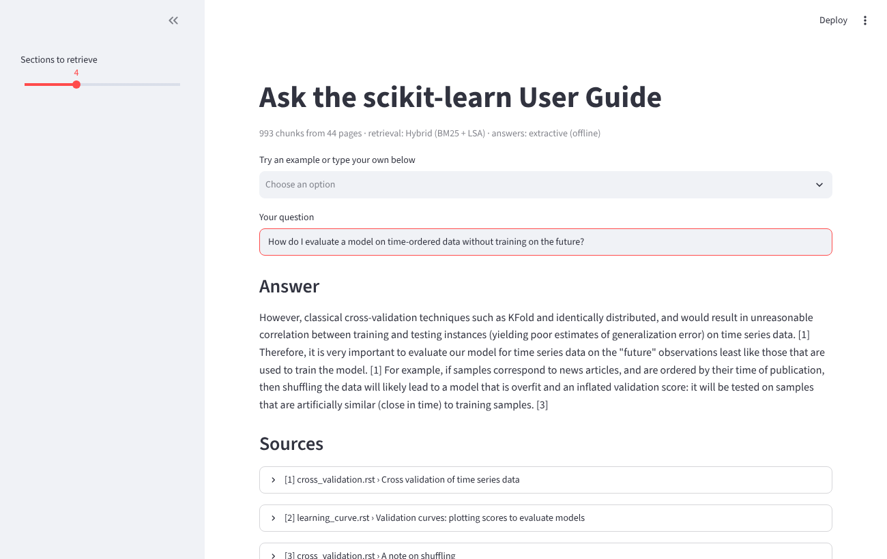
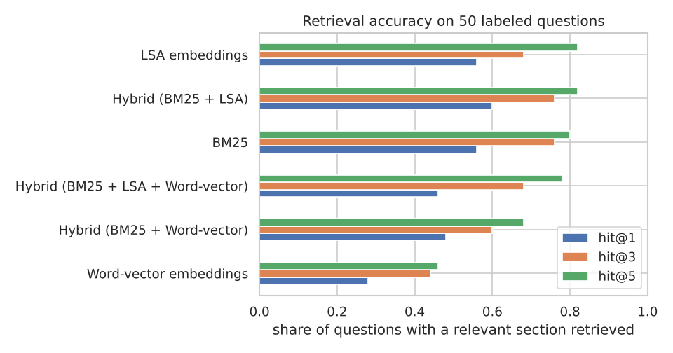

# RAG Question Answering over the scikit-learn User Guide


Ask a practical machine learning question ("which scaler is robust to outliers?") and get an answer drawn from the scikit-learn User Guide, with every sentence citing the page and section it came from. The project compares retrieval methods on a labeled question set, so design choices are backed by numbers.



## How it works

```
User Guide (.rst) ─► parse headings ─► clean markup ─► 180-word chunks with page + section
                                                              │
question ─► BM25 (keywords) ──┐                               ▼
         ─► LSA embeddings ───┴─► reciprocal rank fusion ─► top sections ─► answer with [n] citations
                                                                              (Claude API or offline extractive)
```

| Step | Choice |
|---|---|
| Corpus | 44 pages of the scikit-learn User Guide, 513 sections, 993 chunks |
| Chunking | Split at headings, then 180-word windows with 30-word overlap |
| Retrieval | BM25 + LSA (TF-IDF reduced with SVD), fused with reciprocal rank fusion |
| Generation | Claude, told to answer only from the numbered sources and cite them, when `ANTHROPIC_API_KEY` is set. Otherwise an offline extractive generator picks and cites the best-matching sentences |
| Evaluation | 50 hand-written questions labeled with the section(s) that answer them |

## Retrieval results



| Retriever | Hit@1 | Hit@3 | Hit@5 | MRR |
|---|---:|---:|---:|---:|
| BM25 | 0.56 | 0.76 | 0.80 | 0.663 |
| LSA embeddings | 0.56 | 0.68 | 0.82 | 0.650 |
| Word-vector embeddings (spaCy) | 0.28 | 0.44 | 0.46 | 0.362 |
| **Hybrid BM25 + LSA** | **0.60** | **0.76** | **0.82** | **0.687** |
| Hybrid BM25 + LSA + word vectors | 0.46 | 0.68 | 0.78 | 0.583 |

Hit@k is the share of questions where a correct section is among the top k results.

**Findings**

- BM25 and LSA succeed on partly different questions, so fusing them gives the best top-1 accuracy.
- Averaged general-English word vectors hurt. They blur technical terms ("kernel", "forest") into everyday meanings, and adding them to the hybrid lowers accuracy. More retrievers is not automatically better; measure each one.
- 180-word chunks beat 100-word chunks, while 300-word chunks perform about the same.
- Most of the 9 misses are near-misses: the right page but a neighboring section, such as "Voting Regressor" instead of "Stacked generalization".

**Caveat:** 50 questions is a small set, and it was also used to choose the configuration, so these numbers are optimistic. A separate held-out question set is the next step.

## Project structure

```
src/docqa/
  ingest.py      parse .rst, strip markup, section-aware chunking
  retrievers.py  BM25, LSA, word-vector, hybrid (RRF)
  generate.py    prompt, Claude generator, offline extractive generator
  evaluate.py    hit@k, MRR, latency
  pipeline.py    DocQA: build index, retrieve, answer
notebooks/evaluation.ipynb   experiments and failure analysis
data/eval_questions.csv      50 labeled questions
tests/                       pytest suite, run by GitHub Actions on every push
app.py                       Streamlit app
```

## Run it

```bash
git clone https://github.com/mehtesham13/rag-docs-qa.git
cd rag-docs-qa
pip install -r requirements.txt               # core: retrieval + offline answers
pip install -r requirements-optional.txt      # app, notebook, LLM and word vectors
pytest -q
streamlit run app.py
```

For LLM-written answers, set an API key before starting the app:

```bash
export ANTHROPIC_API_KEY=your_key
```

```python
import sys; sys.path.insert(0, "src")
from docqa.pipeline import DocQA
qa = DocQA()
print(qa.ask("Can gradient boosting handle missing values?").text)
```

## Next steps

1. Add neural sentence embeddings (MiniLM or similar) as a third retriever and re-run the evaluation.
2. Re-rank the top 20 passages with a cross-encoder.
3. Score generated answers for faithfulness: check that each cited claim appears in its source.

## Credits

Documentation text in `data/docs/` comes from [scikit-learn](https://github.com/scikit-learn/scikit-learn) under the BSD 3-Clause License (see `data/docs/SCIKIT_LEARN_LICENSE.txt`). Code in this repository is MIT licensed.

Author: Muhammad Ehtesham · [LinkedIn](https://www.linkedin.com/in/muhammad-ehtesham-dsa)
